# Fluxogramas do Agiliza Transparência

**Versão:** 7.0
**Data:** 2026-09-01
**Fonte normativa:**
[`decisoes/2026-08-31-reuniao-apresentacao-agiliza.md`](decisoes/2026-08-31-reuniao-apresentacao-agiliza.md)
e [`contextoSTC.md`](contextoSTC.md), §33 e §32

Os diagramas representam o contrato consolidado até 31/08/2026. Um ciclo possui um link estável,
uma coleta por UG e um snapshot global. O papel operacional do ponto focal deriva do toggle de cada
UG, desligado por padrão.

## 1. Fluxo do ciclo

```mermaid
flowchart LR
  subgraph ORI["Origem da necessidade"]
    direction TB
    O1["SIMONI monitora o vencimento do objeto<br/>(fora do MVP; registro manual pela STC)"]
    O2["Demanda avulsa<br/>PNTP, TCE, TCU ou periodicidade própria"]
  end
  O1 --> IM["STC identifica ou importa a necessidade"]
  O2 --> IM

  IM --> CR["SERVIDOR STC cria o ciclo<br/>sem exigir nº SEI"]
  CR --> KD{"Objeto fixo ou variável?"}
  KD -->|"fixo"| KF["Referencia modelo XLSX oficial:<br/>campos, uploads e UGs travados"]
  KD -->|"variável"| KV["Escolhe campos diretos e/ou uploads<br/>ao menos um item + UGs"]
  KF --> UGS["Configura somente o toggle focal por UG<br/>padrão desligado"]
  KV --> UGS
  UGS --> ST1["Status: RASCUNHO<br/>editável antes da publicação"]
  ST1 -.->|"pode editar enquanto prepara"| CR
  ST1 --> PUB["PUBLICAÇÃO AUTOMÁTICA E IDEMPOTENTE<br/>gera link e uma coleta por UG<br/>fixo referencia modelo; variável sem XLSX"]

  PUB --> LK["LINK ÚNICO DO CICLO<br/>já funciona e não muda"]
  LK --> AGSEI["Status: PUBLICADO / AGUARDANDO Nº SEI<br/>respostas possíveis; prazo não corre"]
  AGSEI --> SEIN["Servidor STC com permissão de SEI<br/>registra nº e data"]
  SEIN --> AND["Status: EM ANDAMENTO<br/>prazo-base de 5 dias úteis por UG"]

  AND --> MON["MONITORAMENTO<br/>situação de cada UG, toggle e contribuição"]
  MON --> PR1{"1ª prorrogação solicitada<br/>durante o prazo normal?"}
  PR1 -->|"sim"| EXT1["+5 dias úteis"]
  PR1 -->|"não"| PZ{"Prazo da UG?"}
  EXT1 --> PR2{"Hoje é o último dia útil da 1ª extensão<br/>e a 2ª foi solicitada?"}
  PR2 -->|"sim"| EXT2["+5 dias úteis finais"]
  PR2 -->|"não"| PZ
  EXT2 --> PZ
  PZ -->|"vigente"| MON
  PZ -->|"venceu"| ATR["Estado derivado da UG: ATRASADA"]

  MON --> ESC{"Resposta validada precisa<br/>de uma nova demanda?"}
  ESC -->|"não"| DEC
  ESC -->|"sim; P-049 aberta"| NOVO["Cria outro ciclo<br/>resposta validada permanece fechada"]
  NOVO --> IM

  MON --> DEC{"SERVIDOR STC<br/>decide encerrar manualmente?"}
  ATR --> DEC
  DEC -->|"ainda não"| MON
  DEC -->|"reiterar"| REI["Acrescenta nº SEI ao mesmo ciclo<br/>reinicia prazo e restaura 2 prorrogações"]
  REI --> AND
  DEC -->|"encerrar"| REL["ENCERRAMENTO MANUAL<br/>relatório de envios, atrasos<br/>e não ocorrências"]
  REL --> FIN["Status: FINALIZADO<br/>com comprovante de fechamento"]
  FIN --> SEIM[["SEI: registro manual da STC<br/>nada volta automaticamente"]]

  NOTE["CARDINALIDADE: 1 ciclo → 1 snapshot global + 1 link único → N coletas (uma por UG) → N contribuições identificadas. O toggle é por UG e não muda após a publicação."]

  classDef ori fill:#EEEDFE,stroke:#7F77DD,stroke-width:2px,color:#3C3489;
  classDef stc fill:#E6F1FB,stroke:#185FA5,stroke-width:2px,color:#0C447C;
  classDef dec fill:#FAEEDA,stroke:#BA7517,stroke-width:2px,color:#633806;
  classDef alerta fill:#FBE9E7,stroke:#C0392B,stroke-width:2px,color:#8C2A1E;
  classDef prova fill:#E4F5E9,stroke:#1E7A3C,stroke-width:2px,color:#0F4F26;
  classDef canal fill:#FAEEDA,stroke:#BA7517,stroke-width:2px,color:#633806;
  classDef note fill:#FFFAEB,stroke:#BA7517,stroke-width:1px,color:#633806;

  class O1,O2 ori;
  class IM,CR,KF,KV,UGS,ST1,PUB,AGSEI,AND,MON,EXT1,EXT2,NOVO,REI stc;
  class KD,PZ,PR1,PR2,ESC,DEC dec;
  class ATR alerta;
  class REL,FIN prova;
  class LK,SEIN,SEIM canal;
  class NOTE note;
```

## 2. Fluxo da coleta

```mermaid
flowchart LR
  subgraph FONTE["Fontes externas — fora da plataforma"]
    direction TB
    TT[("Tesauro / Tema 3<br/>carga inicial e proveniência")]
    CAT[("Catálogo do Agiliza<br/>fonte operacional versionada")]
    MAP["Mapeamento oficial<br/>informação ↔ UG"]
    TT --> CAT
    CAT --> MAP
  end

  MAP --> K1["SERVIDOR STC inicia o ciclo pelo objeto"]
  subgraph CRIA["Criação do snapshot"]
    direction TB
    K1 --> KD{"Objeto fixo ou variável?"}
    KD -->|"fixo"| KF["Modelo XLSX oficial, campos, uploads e UGs travados<br/>somente toggle focal configurável"]
    KD -->|"variável"| KV["Campos diretos e/ou uploads<br/>ao menos um item + UGs"]
    KF --> K2["Define toggle por UG<br/>desligado por padrão"]
    KV --> K2
  end
  K2 --> PUB["PUBLICAÇÃO AUTOMÁTICA<br/>link e coletas<br/>fixo referencia modelo; variável sem XLSX"]
  PUB --> LK["LINK ÚNICO DO CICLO"]
  LK --> TG{"Toggle focal<br/>da UG ligado?"}

  TG -->|"não"| DIRETO["Modo direto<br/>focal cadastrado apenas observa"]
  DIRETO --> RT0["Respondente abre o link,<br/>verifica vínculo e acessa sua contribuição"]
  DIRETO -.-> OBS["Ponto focal acompanha respostas,<br/>logs e histórico sem bloquear"]

  TG -->|"sim"| PF0["Ponto focal entra por login<br/>e coordena a própria UG"]
  subgraph PFG["Coordenação focal — somente com toggle ligado"]
    direction TB
    PF0 --> PF1["Vê coleta, contribuições e prazo"]
    PF1 --> PF2["Cadastra adjuntas, atribui e remove respondentes"]
    PF2 --> PF3["Respondente acessa a contribuição atribuída"]
  end

  RT0 --> E1{"Tipo de objeto?"}
  PF3 --> E1
  E1 -->|"fixo"| FX["Baixa modelo XLSX oficial<br/>e vê uploads configurados"]
  E1 -->|"variável"| VX["Vê campos diretos e/ou uploads<br/>sem planilha"]
  FX --> ED{"A UG possui alguma informação<br/>sobre o objeto no período?"}
  VX --> ED
  ED -->|"não; toggle desligado"| NOD["RESPONDENTE DECLARA AUSÊNCIA DE INFORMAÇÕES<br/>confirma e justifica direto à STC"]
  ED -->|"não; toggle ligado"| NOF["PONTO FOCAL DECLARA AUSÊNCIA DE INFORMAÇÕES<br/>confirma e justifica"]
  NOF --> NO["AUSÊNCIA TOTAL DA UG<br/>encerra o restante do formulário"]
  NOD --> STCN["STC registra ciência e encerra"]
  NO --> STCN

  ED -->|"sim"| E2["Preenche rascunho conforme o tipo<br/>XLSX fixo ou campos diretos + uploads"]
  E2 --> RES["Pode marcar resposta ou anexo como RESTRITO"]
  RES --> E3["Submete com autor, UG, adjunta e snapshot"]
  E3 --> REV["Revisão automática antes do envio<br/>coluna, campo direto ou upload ausente"]
  REV --> PAR{"Há itens ausentes?"}
  PAR -->|"sim"| NOP["Confirma não ocorrências<br/>e informa justificativa"]
  PAR -->|"não"| CHK
  NOP --> CHK["Checagem estrutural conforme o tipo<br/>célula isolada vazia gera alerta"]
  CHK --> CD{"Pacote resolvido?"}
  CD -->|"não"| E2
  CD -->|"sim"| CP1["Comprovante de envio"]
  CP1 --> ROTA{"Toggle focal da UG?"}
  ROTA -->|"desligado"| STC1["SERVIDOR STC verifica<br/>conteúdo e veracidade"]
  ROTA -->|"ligado"| PFV["Ponto focal confere,<br/>devolve ou encaminha"]
  PFV -->|"devolve com justificativa"| E2
  PFV -->|"encaminha"| STC1

  STC1 --> DEC{"Válida?"}
  DEC -->|"sim; pacote resolvido"| VAL["Registra validação e comprovante<br/>resposta fica fechada"]
  DEC -->|"não"| REJ["Devolve contribuição específica<br/>com justificativa e prazo restante"]
  REJ --> E2
  VAL --> POS{"Surge nova demanda<br/>depois da validação?"}
  POS -->|"não"| MON["Atualiza monitoramento da UG e do ciclo"]
  POS -->|"sim; P-049 aberta"| NCICLO["Cria outro ciclo<br/>sem reabrir a resposta validada"]
  NCICLO --> K1
  STCN --> MON
  MON --> FEC["Fechamento somente manual<br/>por Servidor STC"]
  FEC --> FIM["Fim do escopo operacional do MVP"]

  subgraph TR["Regras transversais do MVP"]
    direction TB
    T1["Isolamento: autor + focal observador/coordenador da UG + STC"]
    T2["Log: autor, data, ciclo, UG, adjunta, snapshot e ação"]
    T3["Tesauro preserva a origem;<br/>Catálogo do Agiliza é operacional"]
  end

  NOTE["CARDINALIDADE: 1 ciclo → 1 snapshot global + link único → 1 coleta por UG → várias contribuições. Edição do catálogo só alcança ciclos novos."]

  classDef fonte fill:#EEEDFE,stroke:#7F77DD,stroke-width:2px,color:#3C3489;
  classDef stc fill:#E6F1FB,stroke:#185FA5,stroke-width:2px,color:#0C447C;
  classDef canal fill:#FAEEDA,stroke:#BA7517,stroke-width:2px,color:#633806;
  classDef orgao fill:#E1F5EE,stroke:#0F6E56,stroke-width:2px,color:#085041;
  classDef trans fill:#F1EFE8,stroke:#888780,stroke-width:2px,color:#444441;
  classDef dec fill:#FAEEDA,stroke:#BA7517,stroke-width:2px,color:#633806;
  classDef alerta fill:#FBE9E7,stroke:#C0392B,stroke-width:2px,color:#8C2A1E;
  classDef prova fill:#E4F5E9,stroke:#1E7A3C,stroke-width:2px,color:#0F4F26;
  classDef note fill:#FFFAEB,stroke:#BA7517,stroke-width:1px,color:#633806;

  class TT,CAT,MAP fonte;
  class K1,KF,KV,K2,PUB,STCN,STC1,VAL,NCICLO,FEC,FIM stc;
  class LK canal;
  class DIRETO,RT0,OBS,PF0,PF1,PF2,PF3,FX,VX,E2,E3,RES,NOD,NOF,NO,REV,NOP,CHK,PFV orgao;
  class KD,TG,E1,ED,PAR,CD,ROTA,DEC,POS dec;
  class REJ alerta;
  class CP1 prova;
  class T1,T2,T3 trans;
  class NOTE note;
```

## Regras de leitura

- O vínculo definitivo CPF–UG continua aberto; o diagrama registra apenas a direção de autenticação.
- Uma resposta ou anexo restrito é visível somente ao autor, ao focal da UG e à STC.
- MT-0050, MT-0054, MT-0055 e MT-0056 já possuem metadados no Tesauro recebido em 2026-08-11.
- A divergência entre o nome v2.6 e a versão interna v2.5 continua aberta em P-024.
- A primeira prorrogação é solicitável no prazo normal; a segunda, somente no último dia útil
  da primeira extensão.
- Validação fecha a resposta; enquanto P-049 estiver aberta, nova demanda exige outro ciclo.
