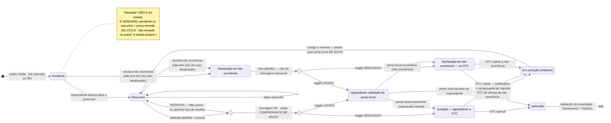
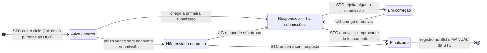

# Fluxogramas — Agiliza Transparência (MVP 1.0)

> **Versão 3.0 — atualizada após a reunião de apresentação do protótipo.** Evolui a v2.0
> acrescentando o que a apresentação trouxe: o **fluxo de gestão do ciclo** (interno da STC — a
> lacuna que a reunião apontou), o **gate de aprovação** do ciclo antes do envio, os **perfis
> internos** (Analista cria / Especialista aprova) e a **“Declaração de não ocorrência”** com duas
> saídas. A v2.0 já havia reescrito os fluxogramas antigos (`fluxograma ponto focal`, `hibrido`,
> `novo`), que refletiam decisões revertidas. Fonte: `contextoSTC.md` §0.3 (novidades do protótipo)
> e §0.1 (matriz do MVP), documento-mãe v9.0.
>
> **Matriz do MVP:** `L1 · R3 · E2 · V1 · T2 · S0 · P2 · O(fixo|variável)`
>
> **Dois fluxos, não um.** Há o **fluxo da coleta** (interação com o órgão — §1, validado pela STC
> como suficiente) e o **fluxo de gestão do ciclo** (interno da STC — §1A, novo). O protótipo cobre
> hoje o primeiro e o gate de aprovação; o ciclo de vida rico do §1A é alvo de refinamento.

---

## O que mudou em relação aos fluxogramas antigos

| Antes (desatualizado) | Agora (MVP 1.0) |
|---|---|
| "Gestão do Tesauro **na plataforma**" | Tesauro é **fonte externa** (Tema 3) — a plataforma **consome, não edita** |
| Ciclo nasce do **SIMONI** | **SIMONI fora do MVP**; a origem é o **mapeamento informação↔órgão** |
| **Envio por boxes** (trava ao enviar) | **Planilha-padrão + upload de anexos** (boxes = futuro) |
| Rejeição **"reabre só o box"** | Rejeição **reabre a coleta/o envio** |
| Verificação com **IA** | **Checagem estrutural** + conferência **humana** da STC (IA = futuro) |
| Só "Respondente" genérico | **Respondente técnico** (dono da informação), com cadastro e visibilidade própria |
| — | **Ciclo × Coleta** (1 ciclo = N coletas; a coleta é um **Forms**) |
| — | **Toggle**: a STC decide se o envio passa pelo **ponto focal** |
| — | **Objeto fixo × variável** (planilha pronta × planilha gerada + anexos) |
| — | **Resposta negativa** e **não enviado no prazo** como **estados próprios** |
| "Quem responde primeiro trava o box" | A coleta aceita **N submissões**, cada uma **identificada** |
| Perfil único "STC" | **Analista** (cria) × **Especialista/aprovador** (revisa e aprova) — nomes a confirmar (P-025) |
| Ciclo criado já sai às UGs | **Gate de aprovação**: criado → pendente de aprovação → aprovado → só então gera coletas/link |
| — | **Fluxo de gestão do ciclo** (interno da STC): origem, aprovação, estados, monitoramento, encerramento (§1A) |
| "Resposta negativa" (uma razão) | **Declaração de não ocorrência** — duas saídas: não tem a informação × não tem atualização |
| Ciclo tem um SEI | **Múltiplos SEI por reiteração** (mesmo link) × **novo ciclo** para recomeço (com relação ao anterior) |

---

## 1 · Fluxo do MVP 1.0 — a coleta (ponta a ponta)

> Este é o **fluxo da coleta** (interação com o órgão). Ele começa **depois** que o ciclo foi
> **criado e aprovado** — ver o **gate de aprovação e o fluxo de gestão do ciclo em §1A**.

```mermaid
flowchart LR
  %% ============ 0 · FONTE DA INFORMAÇÃO (externa — a plataforma NÃO edita) ============
  subgraph FONTE["0 · Fonte da informação — FORA da plataforma"]
    direction TB
    TT[("Tesauro · Tema 3<br/>camada semântica<br/>gerido no TemaTres")]
    MAP["Mapeamento informação ↔ órgão<br/>quais órgãos são fonte<br/>de cada informação<br/>(a STR monta · ainda não existe)"]
    SIM["SIMONI<br/>FORA do MVP<br/>sistema operado à parte<br/>não dispara o ciclo"]
    TT -->|"objetos fixos<br/>exportados"| MAP
  end

  %% ============ 1-2 · STC CRIA O CICLO ============
  N1["1 · STC identifica<br/>a necessidade"]
  MAP ==>|"funil invertido<br/>objeto → órgãos-fonte"| N1

  subgraph CRIA["2 · Criação do ciclo · STC"]
    direction TB
    K1["Seleciona a informação/objeto<br/>(começa pela informação,<br/>não pelo órgão)"]
    K1 --> KD{"Objeto fixo<br/>ou variável?"}
    KD -->|"FIXO · recorrente"| KF["Planilha-padrão PRONTA<br/>(vem do Tesauro)<br/>tabular · sem anexo<br/>ex.: MT-0016 Estagiário"]
    KD -->|"VARIÁVEL · pontual"| KV["STC escolhe os campos →<br/>sistema GERA a planilha<br/>+ anexos por linha<br/>ex.: MT-0018 Licitação"]
    KF --> K2
    KV --> K2
    K2["Adiciona/remove UGs e campos ·<br/>define ANEXOS OBRIGATÓRIOS ·<br/>prazo · notificação"]
    K2 --> K3{{"TOGGLE por ÓRGÃO · cada UG exige<br/>(ou não) a validação do ponto focal<br/>UGs diferentes podem diferir no mesmo ciclo"}}
  end

  N1 --> K1
  K3 --> LK["3 · Gera o LINK ÚNICO DO CICLO<br/>um só para TODAS as UGs · tipo Forms<br/>cada UG vê só as PRÓPRIAS respostas"]
  LK --> SEI["nº do SEI digitado à mão<br/>editável · não bloqueia"]

  %% ---- AS DUAS PORTAS ----
  LK ==>|"PORTA A · notificação<br/>por E-MAIL (plataforma)"| PF0
  SEI ==>|"PORTA B · LINK ANEXADO AO SEI<br/>único elo entre os dois"| ORG["4 · O SEI chega ao órgão<br/>toda a UG pode abrir o link"]
  ORG ==> RT0

  subgraph PFG["5A · PONTO FOCAL — 1 por órgão · entra por LOGIN"]
    direction TB
    PF0["Recebe o e-mail → login"]
    PF0 --> PF1["Vê o CICLO INTEIRO:<br/>todas as coletas e<br/>TODAS as submissões"]
    PF1 --> PF2["Pode pré-cadastrar respondentes<br/>(nome + e-mail)"]
    PF1 --> PF3["Pode responder<br/>OU apenas monitorar"]
  end

  subgraph RTG["5B · RESPONDENTE TÉCNICO — N por coleta · o dono da informação"]
    direction TB
    RT0["Abre o LINK do ciclo"]
    RT0 --> RTD{"Já tem<br/>cadastro?"}
    RTD -->|"SIM"| RT1["Entra com e-mail + senha"]
    RTD -->|"NÃO"| RT2["Cadastro: nome, e-mail,<br/>telefone, cargo, órgão"]
    RT2 --> RT3["Validação por e-mail + cria senha<br/>marca 'criado pelo próprio usuário'<br/>alerta se o órgão do cadastro ≠ o da coleta"]
    RT1 --> RT4["Vê SOMENTE as coletas dele<br/>(não conhece o conceito de ciclo)"]
    RT3 --> RT4
  end

  PF2 -.->|"pré-vincula"| RT0

  %% ============ 6 · ENVIO ============
  subgraph ENVIO["6 · Envio · planilha-padrão + anexos"]
    direction TB
    E1["Baixa a planilha-padrão e<br/>ANALISA o que foi pedido"]
    E1 --> ED{"Tem a<br/>informação?"}
    ED -->|"NÃO"| ENEG["DECLARAÇÃO DE NÃO OCORRÊNCIA<br/>estado próprio · sem planilha · ≠ 'não respondeu'<br/>duas saídas: NÃO TEM A INFORMAÇÃO ×<br/>NÃO TEM ATUALIZAÇÃO no período<br/>respondente técnico OU ponto focal declaram"]
    ED -->|"SIM"| E2["Preenche · pode SALVAR RASCUNHO ·<br/>faz UPLOAD + anexos obrigatórios<br/>(checklist do que falta)"]
    E2 --> E3["Submete<br/>cada submissão é identificada:<br/>a STC sempre sabe quem enviou"]
  end

  RT4 --> E1
  PF3 ==>|"o ponto focal também pode<br/>responder OU declarar não ocorrência"| E1

  %% ============ 7 · CHECAGEM ESTRUTURAL (automática) ============
  E3 --> CHK["7 · CHECAGEM ESTRUTURAL (automática)<br/>DUAS metades, ambas obrigatórias:<br/>(a) cada caixa de anexo tem um arquivo<br/>— nome e conteúdo são livres —<br/>(b) planilha segue a ESTRUTURA do modelo<br/>NUNCA lê o conteúdo das células"]
  CHK --> CD{"Passou?"}
  CD ==>|"NÃO · falta anexo<br/>ou planilha fora do modelo"| E2
  CD -->|"SIM"| CP1["COMPROVANTE DE ENVIO<br/>recibo imediato à UG<br/>(a dor nº 1 das UGs)"]

  %% ============ 8 · TOGGLE ============
  CP1 --> TG{"Toggle da UG<br/>ligado?"}
  TG -->|"SIM · exige validação"| PFV["8 · O PONTO FOCAL consolida<br/>as partes dos setores, dá ciência<br/>e encaminha à STC"]
  TG -->|"NÃO"| STC1
  PFV --> STC1

  %% ---- NÃO OCORRÊNCIA: passa pelo focal (se toggle da UG) e VOLTA À STC ----
  ENEG --> TGN{"Toggle da UG<br/>ligado?"}
  TGN -->|"SIM · declarada pelo respondente"| PFN["Ponto focal dá ciência<br/>e encaminha à STC"]
  TGN -->|"NÃO · ou o PRÓPRIO focal declarou<br/>(vai direto à STC)"| STCN
  PFN --> STCN
  STCN["STC recebe a NÃO OCORRÊNCIA (motivo obrigatório:<br/>FALTA DE INFORMAÇÃO ou DESATUALIZAÇÃO) →<br/>dá ciência · pode EDITAR o ciclo já criado (NÃO cria novo)<br/>e reencaminhar à UG correta"]
  STCN --> VAL
  STCN -.->|"[EM ABERTO] a STC pode REJEITAR a não<br/>ocorrência e devolver para preencher? (P-032)"| E1

  %% ============ 9-11 · STC VERIFICA ============
  STC1["9 · Verificação da STC<br/>HUMANA — abre o arquivo<br/>e confere o CONTEÚDO"]
  STC1 --> DEC{"Aprovado?"}
  DEC -->|"REJEITADO"| REJ["Rejeita com JUSTIFICATIVA<br/>+ COMPROVANTE DE REJEIÇÃO<br/>observações encadeadas (autor + data)"]
  REJ ==>|"REABRE A COLETA / O ENVIO<br/>(não 'o box')"| E2
  DEC -->|"APROVADO"| VAL["10 · Validação de veracidade<br/>(quem executa: em aberto · P-010)"]
  VAL --> FEC["11 · Fechamento do ciclo<br/>status final + COMPROVANTE DE FECHAMENTO"]
  FEC --> FIM["Fim do escopo dos bolsistas"]

  %% ============ SEI: nada volta automaticamente ============
  SEIS[["SEI · registro MANUAL da STC<br/>a plataforma NÃO cria despacho<br/>nem notifica pelo SEI"]]
  REJ -.->|"rejeição"| SEIS
  FEC -.->|"fechamento"| SEIS

  %% ============ TRANSVERSAL / FUTURO / FORA ============
  subgraph TR["Camada transversal (dentro do MVP)"]
    direction TB
    T1["Status + histórico<br/>STC vê tudo · UG só o seu"]
    T2["Notificação e lembrete<br/>de prazo por e-mail"]
    T3["Estado<br/>'não enviado no prazo'"]
  end
  STC1 -.->|"acompanha"| T1

  subgraph FUT["Versões futuras — FORA do MVP 1.0"]
    direction TB
    U1["Chat ancorado ao item<br/>(estilo comentário do Google Docs)"]
    U2["IA · pré-verificador de formato<br/>validação de conteúdo (CPF)"]
    U3["Ranking · dashboards avançados"]
    U4["Unificar planilhas parciais ·<br/>correlação anexo ↔ linha"]
    U5["WhatsApp · envio por boxes · OCR<br/>integração com o SIMONI"]
  end

  subgraph OUT["Fora do escopo dos bolsistas"]
    direction LR
    ST[("Armazenamento")] --> PB[("Publicação")]
  end
  FIM -.->|"depois"| ST

  NOTE["CICLO × COLETA: 1 ciclo pede 1 objeto (no MVP) e usa 1 LINK ÚNICO para TODAS as UGs, tipo Forms · cada COLETA é a RESPOSTA de um respondente (N por ciclo) · cada UG vê SÓ as suas, a STC vê todas · O SEI é SEMPRE o canal formal; a plataforma é o canal PARALELO"]

  classDef fonte fill:#EEEDFE,stroke:#7F77DD,stroke-width:2px,color:#3C3489;
  classDef stc fill:#E6F1FB,stroke:#185FA5,stroke-width:2px,color:#0C447C;
  classDef canal fill:#FAEEDA,stroke:#BA7517,stroke-width:2px,color:#633806;
  classDef orgao fill:#E1F5EE,stroke:#0F6E56,stroke-width:2px,color:#085041;
  classDef trans fill:#F1EFE8,stroke:#888780,stroke-width:2px,color:#444441;
  classDef fora fill:#F1EFE8,stroke:#B4B2A9,stroke-width:2px,color:#888780,stroke-dasharray:4 3;
  classDef dec fill:#FAEEDA,stroke:#BA7517,stroke-width:2px,color:#633806;
  classDef alerta fill:#FBE9E7,stroke:#C0392B,stroke-width:2px,color:#8C2A1E;
  classDef prova fill:#E4F5E9,stroke:#1E7A3C,stroke-width:2px,color:#0F4F26;
  classDef note fill:#FFFAEB,stroke:#BA7517,stroke-width:1px,color:#633806;

  class TT,MAP fonte;
  class N1,K1,KF,KV,K2,LK,CHK,STC1,STCN,VAL,FEC,FIM stc;
  class SEI,ORG,SEIS canal;
  class PF0,PF1,PF2,PF3,RT0,RT1,RT2,RT3,RT4,E1,E2,E3,PFV,PFN orgao;
  class KD,K3,RTD,ED,TG,TGN,DEC,CD dec;
  class ENEG,REJ alerta;
  class CP1 prova;
  class T1,T2,T3 trans;
  class SIM,U1,U2,U3,U4,U5,ST,PB fora;
  class NOTE note;
```

### Como ler

- **Duas portas, não uma.** O **ponto focal** é avisado por **e-mail da plataforma** e entra por **login**.
  O **respondente técnico** chega pelo **link anexado ao SEI** — que toda a UG pode abrir.
- **A STC parte da informação**, não do órgão (funil invertido): escolhe o objeto, e o mapeamento sugere
  quais órgãos são fonte.
- **Três comprovantes**, não um: **envio** (recibo imediato, assim que passa na checagem — era a dor nº 1
  das UGs), **rejeição** e **fechamento**.
- **A checagem estrutural tem duas metades**, ambas obrigatórias: (a) **cada caixa de anexo tem um arquivo**
  — nome e conteúdo são livres, o sistema só vê se subiu algo; (b) a **planilha segue a estrutura do modelo**
  (as colunas). **Nunca o conteúdo das células.** Se qualquer uma reprovar, o envio volta para correção.
- **A declaração de não ocorrência vem depois de analisar o pedido e exige um motivo.** O respondente
  (ou o **próprio ponto focal**) baixa a planilha, vê o que foi pedido e, se for o caso, declara a não
  ocorrência **antes de preencher**, escolhendo o motivo: **falta da informação** ou **desatualização**.
  Ela **não passa pela checagem** (não há planilha a conferir). Se quem declarou foi o **respondente**,
  passa pelo ponto focal quando o **toggle daquela UG** está ligado; se foi o **próprio ponto focal**,
  vai **direto à STC**. A STC **dá ciência** e pode **editar o ciclo já criado** (não cria um novo) —
  inclusive **reencaminhar à UG correta** quando a informação é de outro órgão. **Em aberto:** se a STC
  pode **rejeitar** a não ocorrência (P-032) e se a **edição do ciclo** pela STC volta a passar pelo
  Especialista (P-031).
- **O toggle é por órgão**, não por ciclo: cada UG exige (ou não) a validação do ponto focal, e **UGs
  diferentes podem ter toggles diferentes dentro do mesmo ciclo**. Nos dois casos, o ponto focal
  **enxerga tudo** da sua UG — a diferença é só se ele precisa aprovar antes de subir à STC. **Toda**
  submissão respeita o toggle da UG: a primeira, a **correção reenviada** e a **declaração de não
  ocorrência**. *(O protótipo hoje aplica o toggle por ciclo — ajustar para por órgão é refinamento.)*
- **Nada volta ao SEI automaticamente.** Rejeição e fechamento viram **registro manual** da STC.

---

## 1A · Fluxo do ciclo — gestão interna da STC (NOVO na v3.0)

> Este é o **fluxo do ciclo**: a vida do ciclo do nascimento ao encerramento, dentro da STC. Segue o
> caminho **identificação da informação (SIMONI/portal) → cria o ciclo → registra o SEI → aprovação →
> notifica o ponto focal → coleta → monitoramento → encerramento**. A reunião apontou que o §1
> (coleta) estava suficiente, mas **faltava este segundo fluxo**. Cobre o **gate de aprovação**
> (Analista cria → Especialista aprova), a **migração da demanda**, os **estados do ciclo**, o
> **monitoramento** e o **encerramento com relatório**. O protótipo já tem o gate; o ciclo de vida
> rico abaixo é **alvo de refinamento** (ver `andamento_do_prototipo.md`).

```mermaid
flowchart TB
  %% ---- ORIGEM DA DEMANDA ----
  subgraph ORI["Origem da necessidade"]
    direction TB
    O1["SIMONI · identifica no PORTAL<br/>a informação vencida ou<br/>próxima do prazo<br/>(fora do MVP; migração conceitual)"]
    O2["Demanda avulsa<br/>PNTP · TCE · TCU<br/>periodicidade própria"]
  end
  O1 --> IM["STC identifica/importa<br/>a necessidade"]
  O2 --> IM

  %% ---- CRIAÇÃO (ANALISTA) + SEI ----
  IM --> CR["ANALISTA cria o ciclo<br/>objeto · UGs · campos · anexos ·<br/>prazo · toggle por órgão"]
  CR --> ST1["Status: CRIADO / em preparação"]
  ST1 --> ENV["Enviar para análise<br/>NÃO gera coletas, links<br/>nem notificações"]
  ST1 -.->|"pode editar<br/>enquanto prepara"| CR
  SEIN["nº do SEI (processo formal no SEI, externo) —<br/>informado na plataforma a QUALQUER momento:<br/>antes ou depois da aprovação/envio · editável"]
  SEIN -.->|"vincula ao ciclo quando houver"| CR

  %% ---- GATE DE APROVAÇÃO (ESPECIALISTA) ----
  ENV --> AN["Status: AGUARDANDO ANÁLISE"]
  AN --> ESP{{"ESPECIALISTA revisa<br/>(pode editar/remover UGs)"}}
  ESP -->|"solicita ajustes<br/>(exige observação)"| AJ["Status: AJUSTES SOLICITADOS<br/>volta ao Analista"]
  AJ -->|"Analista corrige<br/>e reenvia"| AN
  ESP -->|"APROVA"| APR["Status: APROVADO<br/>gera o LINK ÚNICO do ciclo<br/>(um só p/ todas as UGs · tipo Forms)"]

  %% ---- ENTRA NO FLUXO DA COLETA ----
  APR --> LKN["Link anexado ao SEI +<br/>NOTIFICA O PONTO FOCAL por e-mail<br/>(a UG passa a poder responder)"]
  LKN --> ENVI["Status: ENVIADO"]
  ENVI ==>|"daqui vale o FLUXO DA COLETA (§1)<br/>ponto focal e respondentes técnicos"| AND["Status: EM ANDAMENTO<br/>há submissões chegando"]

  %% ---- MONITORAMENTO ----
  AND --> MON["MONITORAMENTO<br/>quem respondeu · quem não ·<br/>quem declarou não ocorrência"]
  MON --> PZ{"Prazo?"}
  PZ -->|"dentro do prazo"| MON
  PZ -->|"venceu · faltam respostas"| ATR["Status: ATRASADO"]
  ATR -.->|"BACKLOG: prorrogação<br/>mantém EM ANDAMENTO"| AND

  %% ---- ENCERRAMENTO ----
  MON --> DEC{"Todas aprovadas<br/>ou hora de encerrar?"}
  ATR --> DEC
  DEC -->|"decidir antes de encerrar"| REI{"Reiterar?"}
  REI -->|"SIM · mesmo ciclo"| SEI2["Acrescenta OUTRO nº SEI<br/>ao MESMO ciclo (mesmo link)"]
  SEI2 --> MON
  REI -->|"recomeçar do zero"| NOVO["NOVO ciclo<br/>com indicador de relação<br/>ao anterior (desmembramento)"]
  REI -->|"NÃO · encerrar"| REL["ENCERRAMENTO<br/>gera RELATÓRIO: quem enviou ·<br/>quem não enviou · quem declarou não ter"]
  DEC -->|"todas aprovadas"| REL
  REL --> FIN["Status: FINALIZADO<br/>+ comprovante de fechamento"]
  FIN --> SEIM[["SEI · registro MANUAL da STC<br/>nada volta automaticamente"]]

  classDef ori fill:#EEEDFE,stroke:#7F77DD,stroke-width:2px,color:#3C3489;
  classDef stc fill:#E6F1FB,stroke:#185FA5,stroke-width:2px,color:#0C447C;
  classDef dec fill:#FAEEDA,stroke:#BA7517,stroke-width:2px,color:#633806;
  classDef alerta fill:#FBE9E7,stroke:#C0392B,stroke-width:2px,color:#8C2A1E;
  classDef prova fill:#E4F5E9,stroke:#1E7A3C,stroke-width:2px,color:#0F4F26;
  classDef canal fill:#FAEEDA,stroke:#BA7517,stroke-width:2px,color:#633806;

  class O1,O2 ori;
  class IM,CR,ST1,ENV,AN,AJ,APR,ENVI,AND,MON,SEI2,NOVO stc;
  class ESP,PZ,DEC,REI dec;
  class ATR alerta;
  class REL,FIN prova;
  class SEIN,LKN,SEIM canal;
```

### Como ler o fluxo de gestão do ciclo

- **A criação não envia nada.** O Analista prepara o ciclo; enviar “para análise” só o coloca na
  fila do Especialista. **Nenhuma coleta, link ou notificação existe antes da aprovação** — a
  maturidade das equipes varia, então alguém precisa aprovar antes de sair.
- **O gate é auditável.** O Especialista pode editar, remover UGs ou **solicitar ajustes** (com
  observação obrigatória), devolvendo ao Analista; ou **aprovar**, que é o único ato que gera o
  **link único do ciclo** e libera às UGs. **O nº do SEI pode ser informado a qualquer momento** —
  antes ou depois da aprovação/envio —, não trava a criação.
- **Reiterar ≠ recomeçar.** Reiterar acrescenta **outro nº de SEI ao mesmo ciclo** (o **mesmo link**
  continua valendo e o prazo é reaberto), quando parte respondeu e se quer cobrar de novo. Recomeçar
  do zero cria um **novo ciclo**, com um indicador de relação ao anterior. *(No protótipo: um SEI por
  ciclo — refinamento.)*
- **Encerrar gera relatório.** Antes de encerrar, decide-se reiterar; ao encerrar, sai o
  **relatório de quem enviou / não enviou / declarou não ter** — a necessidade de “dar ciência ao
  chefe”. *(No protótipo: não existe — refinamento.)*
- **O encerramento é sempre manual da STC** — **não há encerramento automático** em nenhum momento.
  A **prorrogação de prazo** (a coleta que pediu prorrogação segue “em andamento”; as demais vão a
  “atrasado”) fica no **backlog**.
- **Nomes dos perfis a confirmar (P-025):** Analista/Especialista (protótipo) × superintendente /
  STR / operador (reunião). O **painel gerencial** (ciclos abertos/enviados/atrasados/pendentes de
  aprovação) é item futuro.

---

## 2 · Estados da submissão (a resposta do respondente técnico)

---

## 3 · Estados do ciclo (visão da STC e do ponto focal)

---

## Pendências que ainda afetam estes fluxos

| Código | Em aberto | Como está desenhado aqui |
|---|---|---|
| **P-019** | Uma coleta pede 1 objeto ou vários? Por órgão ou por setor? | **1 coleta = 1 objeto**, por órgão (distribuição interna via focal) |
| **P-020** | ~~por órgão × por ciclo?~~ **DECIDIDO: por órgão** | **Por órgão**; UGs diferentes podem ter toggles diferentes no mesmo ciclo. *(Protótipo faz por ciclo — ajustar.)* |
| **P-021** | Granularidade da não ocorrência: **coleta**, **linha** ou **campo**? | Pela **coleta**, com **motivo obrigatório** (falta de informação × desatualização) |
| **P-022** | Como chega o **mapeamento informação↔órgão** (lista da Alessandra)? | Fonte externa, formato indefinido — bloqueia a pré-seleção de UGs |
| **P-023** | Justificativa de anexo faltante destrava o envio? | Não destrava (a confirmar) |
| **P-024** | Contradições/versionamento do Tesauro | Segue a coluna **Fluxo de Origem** |
| **P-025** | Nomes/nº dos perfis internos da STC | Analista + Especialista (a confirmar) |
| **P-026** | Objeto fixo pode **alterar campos obrigatórios**? | Em aberto (ver nota abaixo) |
| **P-027** | Metadados dos **8 objetos automatizados** ficam na plataforma? | Em aberto (protótipo mantém como referência, fora da criação) |
| **P-028** | **Armazenamento** (protótipo→MVP): banco × código; Tesauro em banco × código | Em aberto |
| **P-029** | UG **sinalizar à STC** um erro no pedido / **apontar qual UG** tem a informação | Reencaminho pós-não-ocorrência **confirmado**; canal de sinalização mais amplo — escopo em aberto |
| **P-030** | **CPF via API** (base de servidores) em vez de login e-mail/senha | Em aberto (evolução de P-016) |
| **P-031** | A **edição do ciclo pela STC** (ajuste pós-não-ocorrência) volta a passar pelo Especialista? | Em aberto |
| **P-032** | A STC pode **rejeitar** uma declaração de não ocorrência? | Em aberto |
| **P-010** | Quem, na STC, valida a **veracidade**? | Etapa existe, executor não nomeado |

> **Nota sobre P-026 (campos do objeto fixo).** Alterar **destinatários (UGs)** de um objeto fixo é
> tranquilo. Alterar os **campos obrigatórios** é que é a questão: se a tabela do objeto fixo é
> **fixa** (padrão do Tesauro, para garantir comparabilidade e casar com o modelo oficial), então os
> obrigatórios não deveriam ser editáveis. A alternativa elegante é tratar **todo objeto como
> variável** por baixo, e o "objeto fixo" ser apenas um **preset salvo** (um variável pré-definido a
> partir do Tesauro) — aí editar campos passa a ser natural. Lean sugerido: **os obrigatórios
> normativos do Tesauro ficam travados (não se removem), mas pode-se acrescentar campos**; UGs sempre
> editáveis. Decisão da STC.

---

## Regras que os fluxos não podem violar

1. O **SEI é sempre o canal formal**; a plataforma é o canal **paralelo**. O único elo é o **link da coleta anexado ao SEI**.
2. **Nada volta ao SEI automaticamente** — rejeição e fechamento geram, no máximo, **registro manual** da STC. A plataforma **não cria despacho**.
3. O **nº do SEI** é digitado à mão, **editável**, e **não bloqueia** a criação do ciclo.
4. **Toda submissão é identificada** — a STC sempre sabe **quem** respondeu.
5. **Comprovantes obrigatórios**: de **envio**, de **rejeição** e de **fechamento**.
6. **Declaração de não ocorrência** ("não tenho a informação" × "não tem atualização") é **estado próprio**, distinto de "não respondeu".
7. A **checagem é estrutural**, nunca de conteúdo: anexos obrigatórios presentes (basta o upload, mesmo com título diferente), planilha conforme o modelo e órgão coerente.
8. **Histórico:** a STC vê tudo; a UG vê **só o seu**.
9. **Adicionar UGs na criação** vale para objeto fixo **e** variável. **Alterar os campos obrigatórios** do objeto **fixo** é questão em aberto (P-026): os obrigatórios normativos do Tesauro tendem a ficar travados.
10. **A criação não envia nada.** Coletas, link e notificações só existem **após a aprovação** do ciclo (gate — §1A).
