# Fluxogramas do Agiliza Transparência

**Versão:** 4.0  
**Data:** 2026-07-30  
**Fonte normativa:** [`contextoSTC.md`](contextoSTC.md)

Os diagramas representam decisões vigentes. Nós tracejados indicam pendências ou processos
provisórios que não devem ser tratados como regra definitiva.

## 1. Criação, aprovação e comunicação do ciclo

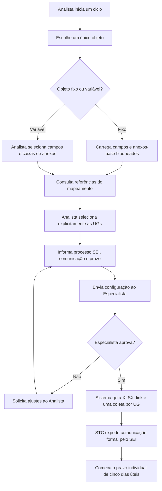

## 2. Distribuição da coleta pelo ponto focal

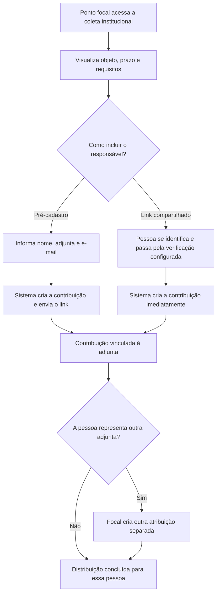

## 3. Cadastro de adjunta e remoção de respondente

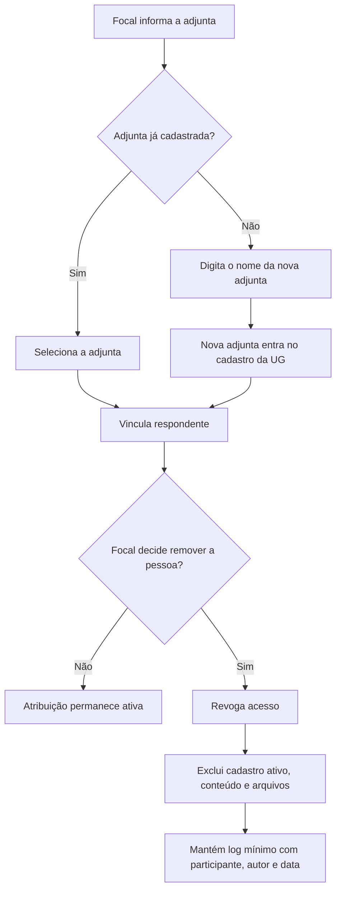

## 4. Contribuição por adjunta

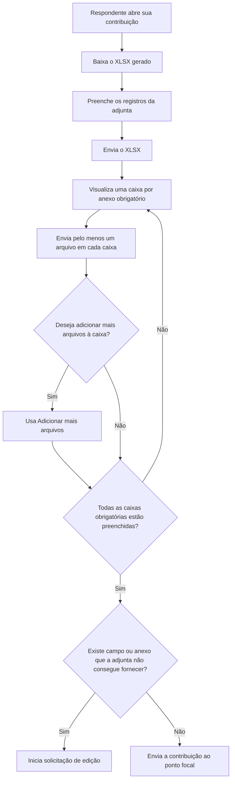

## 5. Conferência e conclusão institucional

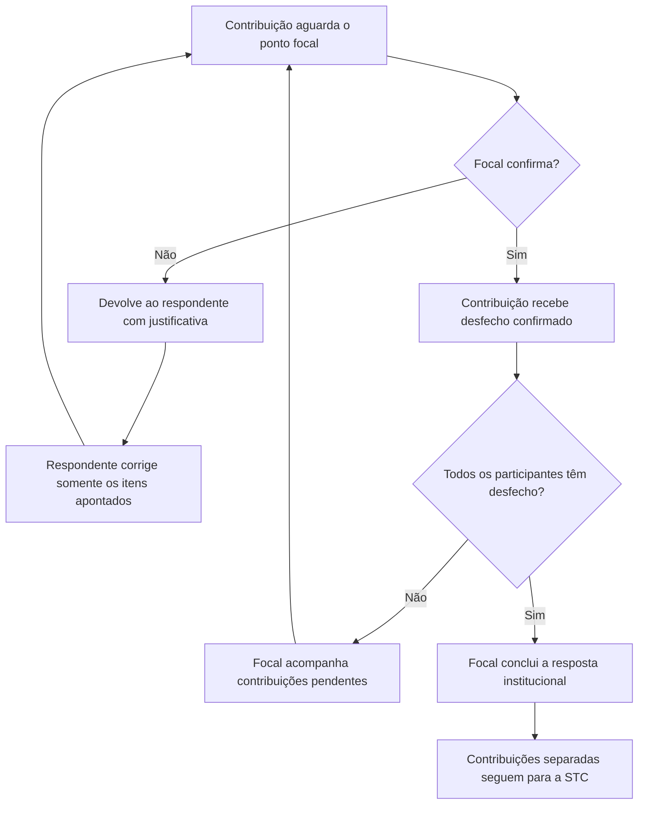

Desfechos aceitos: contribuição confirmada, não ocorrência da adjunta ou remoção formal.

## 6. Validação e correção pela STC

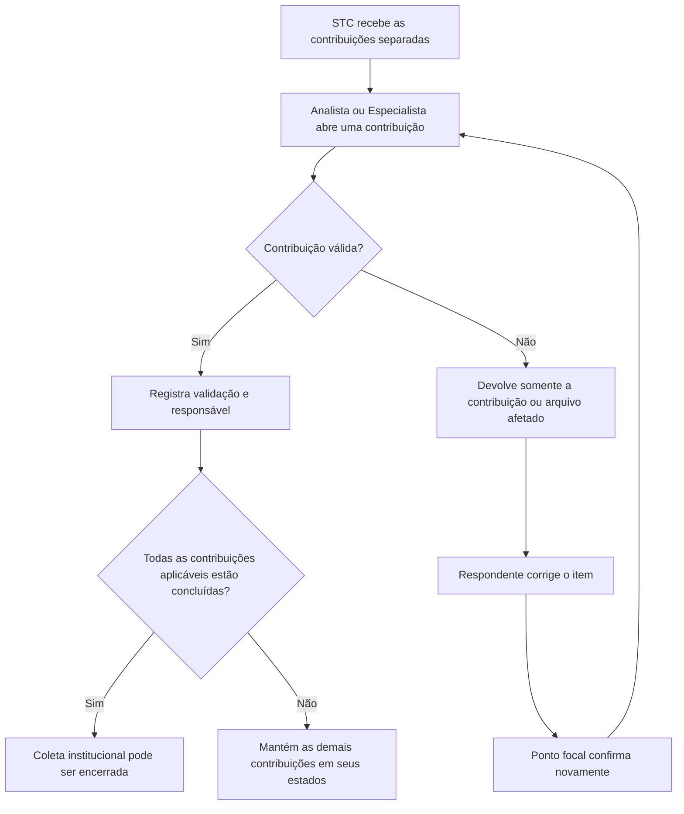

## 7. Não ocorrência

### 7.1 UG inteira

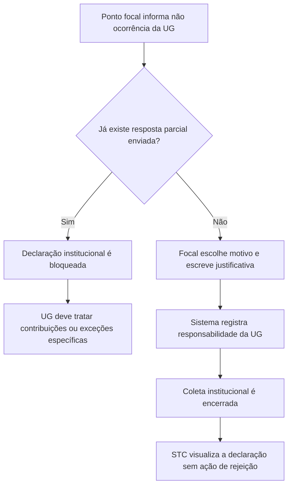

### 7.2 Adjunta

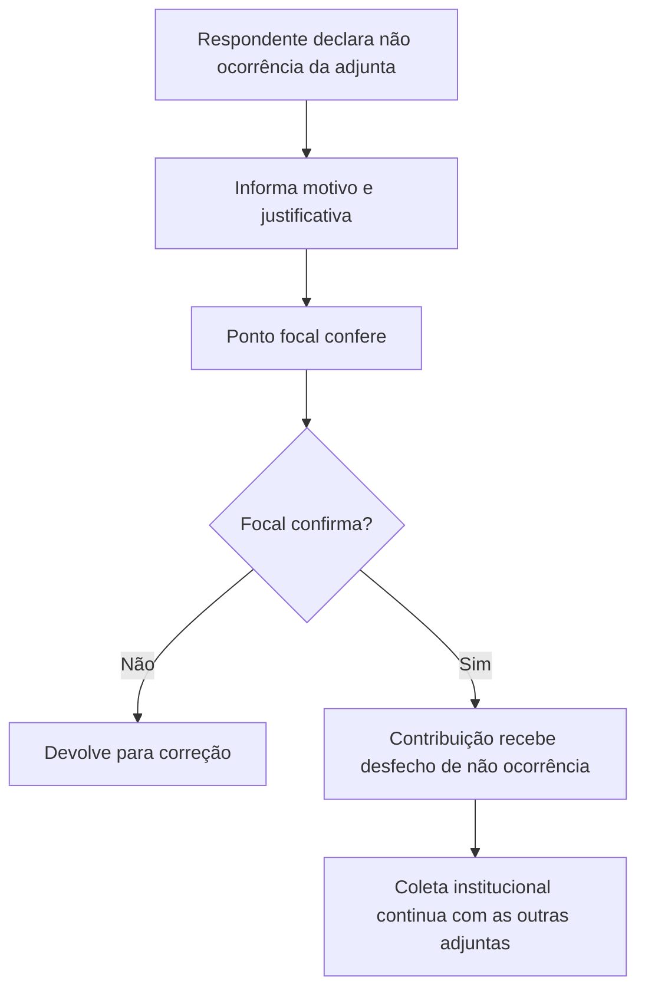

## 8. Solicitação de edição de campo ou anexo

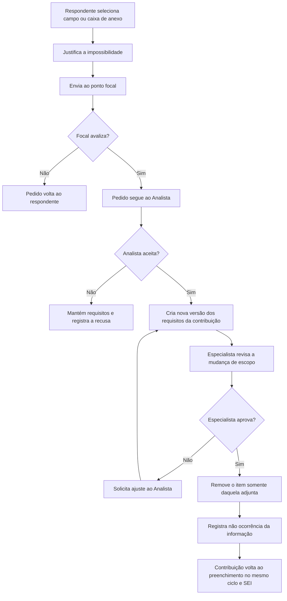

## 9. Prorrogação individual da UG

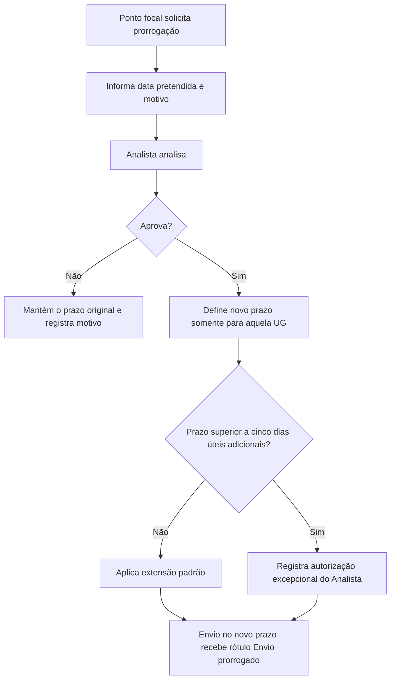

## 10. Indicação e troca da UG responsável

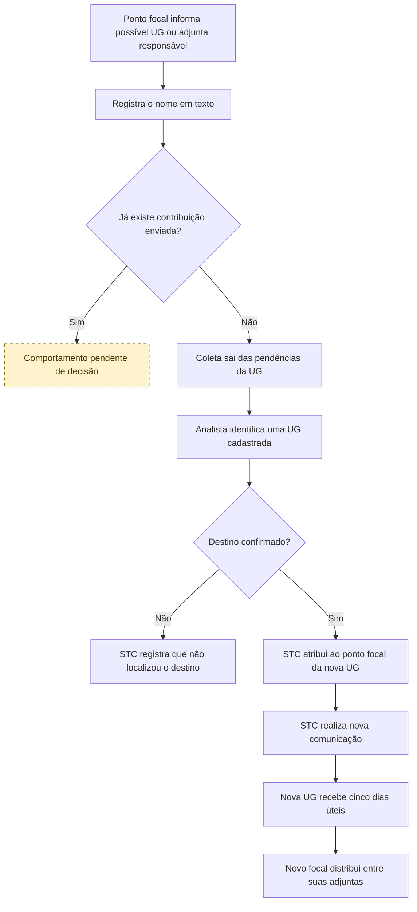

Para a UG anterior, a coleta deixa de aparecer. O histórico da troca permanece exclusivo da STC.

## 11. Vencimento, prorrogação e “não enviado”

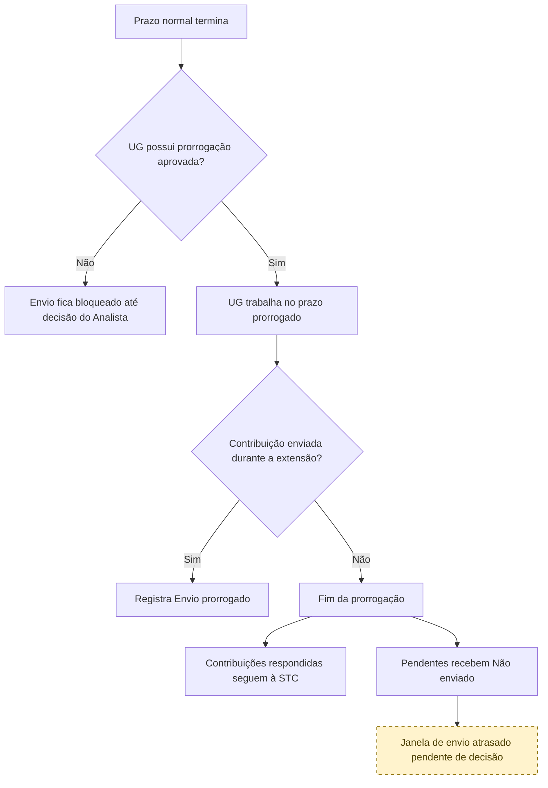

## 12. Cobranças e contatos não respondidos

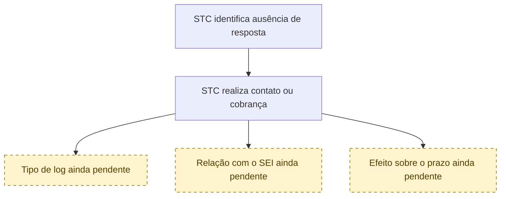

O diagrama registra apenas a necessidade operacional. Não define reiteração automática,
reabertura ou novo prazo.

## 13. Visão ponta a ponta

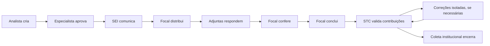
