# Fluxogramas do Agiliza Transparência

**Versão:** 5.1  
**Data:** 2026-08-03  
**Fonte normativa:** [`contextoSTC.md`](contextoSTC.md)

Os diagramas abaixo substituem os fluxos anteriores. Um ciclo possui um modelo-base e um link único compartilhado pelas UGs destinatárias; cada UG usa uma coleta local, versionável e isolada das demais.

## 1. Fluxo do ciclo

```mermaid
flowchart LR
  subgraph ORI["Origem da necessidade"]
    direction TB
    O1["SIMONI monitora o vencimento do objeto<br/>(fora do MVP; registro manual pela STC)"]
    O2["Demanda avulsa<br/>PNTP, TCE, TCU ou periodicidade própria"]
  end
  O1 --> IM["STC identifica ou importa a necessidade"]
  O2 --> IM

  IM --> CR["ANALISTA cria o ciclo<br/>objeto, campos, anexos e prazo-base"]
  CR --> MOD["Define 1 MODELO-BASE DE COLETA<br/>(tipo Forms) para todas as UGs"]
  MOD --> UGS["Seleciona UGs e configura por UG:<br/>prazo, notificação e toggle do ponto focal"]
  UGS --> SEIN["Registra nº(s) do SEI<br/>editável; não bloqueia a criação"]
  SEIN --> ST1["Status: CRIADO / em preparação"]
  ST1 --> ENV["Enviar para análise<br/>não gera coleta, link ou notificação"]
  ST1 -.->|"pode editar enquanto prepara"| CR

  ENV --> AN["Status: AGUARDANDO ANÁLISE"]
  AN --> ESP{{"ESPECIALISTA revisa<br/>(pode editar)"}}
  ESP -->|"solicita ajustes"| AJ["Status: AJUSTES SOLICITADOS<br/>volta ao Analista"]
  AJ -->|"Analista corrige e reenvia"| AN
  ESP -->|"aprova"| APR["Status: APROVADO<br/>gera 1 coleta local por UG,<br/>todas derivadas do modelo-base"]

  APR --> LK["LINK ÚNICO DO CICLO<br/>compartilhado pelas UGs; acesso isolado por UG"]
  LK --> COM["STC registra a comunicação formal no SEI<br/>e notifica o ponto focal por e-mail"]
  COM --> AND["Status: EM ANDAMENTO<br/>cada UG recebe o próprio prazo e coleta"]

  AND --> UGM["UG solicita mudança no seu formulário<br/>(campo, anexo ou orientação)"]
  UGM --> ALA["ANALISTA aceita ou recusa<br/>e prepara a versão local"]
  ALA --> ELA{{"ESPECIALISTA aprova<br/>a alteração local?"}}
  ELA -->|"não"| UGM
  ELA -->|"sim"| VUG["NOVA VERSÃO SOMENTE DA UG<br/>preserva submissões e pede complemento<br/>apenas do requisito alterado"]
  VUG --> AND

  AND --> MON["MONITORAMENTO<br/>situação de cada UG e submissão"]
  MON --> PZ{"Prazo da UG?"}
  PZ -->|"dentro do prazo"| MON
  PZ -->|"venceu"| ATR["Status da UG: ATRASADA"]
  ATR -->|"envio permitido com justificativa obrigatória"| AND

  MON --> DEC{{"Analista ou Especialista<br/>decide encerrar manualmente?"}}
  ATR --> DEC
  DEC -->|"ainda não"| MON
  DEC -->|"reiterar"| REI["Acrescenta nº SEI ao mesmo ciclo<br/>e reabre o prazo das UGs definidas"]
  REI --> AND
  DEC -->|"novo ciclo"| NOVO["Cria novo ciclo ligado ao anterior"]
  NOVO --> IM
  DEC -->|"encerrar"| REL["ENCERRAMENTO MANUAL<br/>relatório: enviou, não enviou,<br/>atrasou e não ocorrência"]
  REL --> FIN["Status: FINALIZADO<br/>com comprovante de fechamento"]
  FIN --> SEIM[["SEI: registro manual da STC<br/>nada volta automaticamente"]]

  NOTE["CARDINALIDADE: 1 ciclo → 1 modelo-base + 1 link único → N coletas locais (uma por UG) → N submissões identificadas por coleta. Uma versão local nunca altera outra UG."]

  classDef ori fill:#EEEDFE,stroke:#7F77DD,stroke-width:2px,color:#3C3489;
  classDef stc fill:#E6F1FB,stroke:#185FA5,stroke-width:2px,color:#0C447C;
  classDef dec fill:#FAEEDA,stroke:#BA7517,stroke-width:2px,color:#633806;
  classDef alerta fill:#FBE9E7,stroke:#C0392B,stroke-width:2px,color:#8C2A1E;
  classDef prova fill:#E4F5E9,stroke:#1E7A3C,stroke-width:2px,color:#0F4F26;
  classDef canal fill:#FAEEDA,stroke:#BA7517,stroke-width:2px,color:#633806;
  classDef note fill:#FFFAEB,stroke:#BA7517,stroke-width:1px,color:#633806;

  class O1,O2 ori;
  class IM,CR,MOD,UGS,ST1,ENV,AN,AJ,APR,AND,ALA,VUG,MON,REI,NOVO stc;
  class ESP,ELA,PZ,DEC dec;
  class ATR alerta;
  class REL,FIN prova;
  class SEIN,LK,COM,SEIM canal;
  class NOTE note;
```

## 2. Fluxo da coleta

```mermaid
flowchart LR
  subgraph FONTE["Fonte externa — fora da plataforma"]
    direction TB
    TT[("Tesauro / Tema 3<br/>catálogo versionado")]
    MAP["Mapeamento informação ↔ UG<br/>mantido externamente pela STC"]
    TT --> MAP
  end

  MAP --> K1["ANALISTA inicia o ciclo pelo objeto"]
  subgraph CRIA["Criação do modelo-base"]
    direction TB
    K1 --> KD{"Objeto fixo ou variável?"}
    KD -->|"fixo"| KF["Carrega modelo, campos e anexos-base<br/>da versão importada do Tesauro"]
    KD -->|"variável"| KV["Analista escolhe campos e anexos<br/>e o sistema gera a planilha"]
    KF --> K2["Seleciona UGs, prazo e toggle por UG"]
    KV --> K2
  end
  K2 --> GATE{{"ESPECIALISTA aprova o ciclo"}}
  GATE --> LK["LINK ÚNICO DO CICLO<br/>mesmo modelo-base para todas as UGs"]

  LK --> PF0["Porta A: ponto focal recebe e-mail e entra por login"]
  LK --> RT0["Porta B: respondente abre o link comum"]

  subgraph PFG["Ponto focal — visão exclusiva da própria UG"]
    direction TB
    PF0 --> PF1["Vê a coleta local, submissões e prazo da UG"]
    PF1 --> PF2["Pré-cadastra, remove e atribui respondentes"]
    PF2 --> ADJ{"Adjunta cadastrada?"}
    ADJ -->|"sim"| PF3["Vincula respondente à adjunta"]
    ADJ -->|"não"| PFA["Informa 'adjunta não cadastrada'"]
    PFA --> STCA["Analista ou Especialista cadastra<br/>a adjunta e vincula à UG"]
    STCA --> PF3
    PF1 --> PFR["Pode responder, monitorar ou<br/>formalizar não ocorrência"]
  end

  subgraph RTG["Respondente — acesso somente às próprias submissões"]
    direction TB
    RT0 --> RTD{"Já possui vínculo verificado?"}
    RTD -->|"sim"| RT1["Acessa apenas suas submissões"]
    RTD -->|"não"| RT2["Informa CPF e seleciona a UG<br/>(vínculo CPF ↔ UG em definição)"]
    RT2 --> RT3["Cadastro complementar e verificação futura"]
    RT3 --> RT1
  end

  PF3 -.->|"atribui"| RT1
  RT1 --> E1["Baixa a planilha da versão local da UG"]
  PFR --> E1
  E1 --> ED{"Tem a informação?"}
  ED -->|"não"| SNO["RESPONDENTE SINALIZA NÃO OCORRÊNCIA<br/>ao ponto focal; não chega direto à STC"]
  SNO --> PFN["Ponto focal analisa a sinalização"]
  PFN -->|"formaliza"| NO["DECLARAÇÃO INSTITUCIONAL<br/>motivo e justificativa"]
  PFN -->|"devolve para preenchimento"| E1
  NO --> STCN["STC registra ciência: não ocorrência<br/>ou avalia redirecionamento indicado"]

  ED -->|"sim"| E2["Preenche, salva rascunho, envia XLSX<br/>e arquivos em cada caixa obrigatória"]
  E2 --> RES["Pode marcar resposta ou anexo como RESTRITO"]
  RES --> LATE{"Prazo vencido?"}
  LATE -->|"não"| E3["Submete; autor, UG, adjunta e versão ficam registrados"]
  LATE -->|"sim"| JUS["Exige justificativa obrigatória do atraso"]
  JUS --> E3
  E3 --> CHK["Checagem estrutural automática<br/>XLSX conforme modelo + anexos presentes"]
  CHK --> CD{"Passou?"}
  CD -->|"não"| E2
  CD -->|"sim"| CP1["Comprovante de envio"]

  CP1 -->|"entra em revisão"| TG

  subgraph REV["Fase de revisão — ponto focal + STC (depois do envio)"]
    direction TB
    TG{"Toggle da UG ligado?"}
    TG -->|"não"| STC1["Analista ou Especialista verifica<br/>conteúdo e veracidade"]
    TG -->|"sim"| PFV["Ponto focal encaminha à STC<br/>ou devolve só esta submissão"]
    PFV -->|"encaminha"| STC1
    STC1 --> DEC{"Válida?"}
    DEC -->|"sim"| VAL["Registra validação e comprovante"]
    DEC -->|"não"| REJ["Devolve submissão específica<br/>com justificativa"]
  end

  PFV -->|"devolve com justificativa"| E2
  REJ --> E2
  VAL --> MON["Atualiza o monitoramento da UG e do ciclo"]
  STCN --> MON

  MON --> FEC["Fechamento somente manual por<br/>Analista ou Especialista"]
  FEC --> FIM["Fim do escopo operacional do MVP"]

  subgraph TR["Regras transversais do MVP"]
    direction TB
    T1["Isolamento: respondente autor + ponto focal da UG + STC"]
    T2["Log: autor, data, ciclo, UG, adjunta, versão e ação"]
    T3["Tesauro é importado/consumido;<br/>edição do catálogo é candidata à v2"]
    T4["Toggle por UG poderá ser revisto na v2"]
  end

  NOTE["CARDINALIDADE: 1 ciclo → 1 modelo-base + link único compartilhado → 1 coleta local por UG → várias submissões. Alteração local aprovada não altera as outras UGs."]

  classDef fonte fill:#EEEDFE,stroke:#7F77DD,stroke-width:2px,color:#3C3489;
  classDef stc fill:#E6F1FB,stroke:#185FA5,stroke-width:2px,color:#0C447C;
  classDef canal fill:#FAEEDA,stroke:#BA7517,stroke-width:2px,color:#633806;
  classDef orgao fill:#E1F5EE,stroke:#0F6E56,stroke-width:2px,color:#085041;
  classDef trans fill:#F1EFE8,stroke:#888780,stroke-width:2px,color:#444441;
  classDef dec fill:#FAEEDA,stroke:#BA7517,stroke-width:2px,color:#633806;
  classDef alerta fill:#FBE9E7,stroke:#C0392B,stroke-width:2px,color:#8C2A1E;
  classDef prova fill:#E4F5E9,stroke:#1E7A3C,stroke-width:2px,color:#0F4F26;
  classDef note fill:#FFFAEB,stroke:#BA7517,stroke-width:1px,color:#633806;

  class TT,MAP fonte;
  class K1,KF,KV,K2,LK,STCA,STCN,STC1,VAL,FEC,FIM stc;
  class PF0,PF1,PF2,PF3,PFA,PFR,PFN,PFV,RT0,RT1,RT2,RT3,E1,E2,E3,RES,SNO,NO orgao;
  class KD,GATE,ADJ,RTD,ED,CD,LATE,TG,DEC dec;
  class REJ alerta;
  class CP1 prova;
  class T1,T2,T3,T4 trans;
  class NOTE note;
```

## Regras de leitura

- A escolha definitiva de vínculo CPF–UG permanece aberta; o diagrama documenta apenas a intenção autorizada de usar CPF.
- Uma resposta ou anexo marcado como restrito é visível somente ao respondente autor, ao ponto focal da UG e aos perfis da STC.
- Os objetos MT-0050, MT-0054, MT-0055 e MT-0056 permanecem fora da criação até a STC fornecer o Tesauro atualizado com metadados e classificação oficiais.
