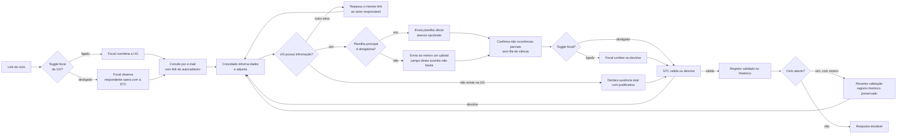
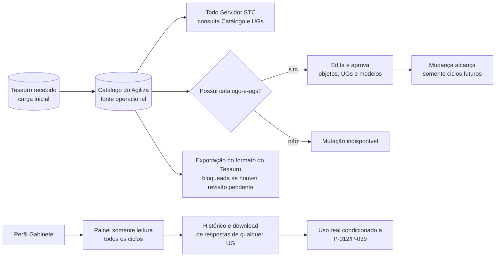

# Fluxogramas do Agiliza Transparência

**Versão:** 8.0  
**Data:** 2026-09-10  
**Fontes normativas:** [`regras-de-negocio.md`](regras-de-negocio.md),
decisões de 31/08 em
[`decisoes-de-reunioes/2026-08-31-reuniao-apresentacao-agiliza.md`](decisoes-de-reunioes/2026-08-31-reuniao-apresentacao-agiliza.md)
e consolidação posterior em [`contexto.md`](contexto.md).

Os diagramas representam o contrato consolidado. Um ciclo possui um snapshot publicado, um link e
uma coleta por UG. Não há redirecionamento entre UGs; quando a informação pertence a outro setor, o
link é repassado, e a ausência total continua sendo justificada pela UG.

## 1. Ciclo, prazo e encerramento

```mermaid
flowchart LR
  N["Necessidade identificada pela STC"] --> C["Servidor STC cria ciclo\npara um objeto"]
  C --> T{"Objeto exige\nplanilha oficial?"}
  T -->|sim| F["Referencia modelo cadastrado\ne UGs oficiais"]
  T -->|não| V["Configura campos e uploads\ne seleciona UGs"]
  F --> P["Publicação automática\nsnapshot + link + coleta por UG"]
  V --> P
  P --> A["Aberto, aguardando número SEI\nrespostas possíveis; prazo parado"]
  A --> S["Capacidade sei-link-texto\nregistra número SEI"]
  S --> E["Em andamento\n5 dias úteis por UG"]
  E --> R{"Prorrogação?"}
  R -->|primeira| R1["+5 dias úteis"]
  R1 -->|segunda, no último dia útil| R2["+5 dias úteis"]
  R -->|não| M["Monitoramento"]
  R2 --> M
  M --> D{"Decisão manual da STC"}
  D -->|reiterar| S2["Novo número SEI\nreinicia prazo e slots"]
  S2 --> E
  D -->|encerrar| X["Ciclo encerrado\nvalidações não reabrem"]
  D -->|continuar| M
  X --> Z["Registro manual no SEI\nsem integração automática"]
```

Regras centrais:

- todo ciclo recebe número SEI antes do encerramento;
- criação não exige justificativa nem aprovação de outro perfil;
- o Catálogo e seus modelos podem mudar apenas ciclos futuros;
- ciclo publicado por engano pode ser excluído, invalidando o link e preservando respostas enviadas;
- o estado aberto/encerrado limita a reversão de uma validação.

## 2. Convite, contribuição e validação

## 3. Catálogo, capacidades e consulta do Gabinete

## Regras de leitura

- `sei-link-texto` habilita número, link e texto do SEI; `catalogo-e-ugs` habilita mutações do
  Catálogo e do diretório de UGs.
- A exportação do histórico é disponível a todo Servidor STC; o modelo macro permanece em P-050.
- O Gabinete não altera dados e seu alcance integral foi confirmado; sigilo, LGPD, disponibilidade,
  retenção e descarte continuam em P-012/P-039.
- O efeito de reverter validação no prazo da UG continua em P-060.
- A infraestrutura de e-mail do piloto continua em B-002.
