# Handoff técnico do backend — V1 mínima

**Status:** referência de implementação para a V1; não substitui contrato HTTP, OpenAPI, esquema
de banco ou autenticação institucional aprovados. No snapshot de 2026-10-12, o repositório canônico
privado
[`Oxygeni-Projetos-Estagiarios/agiliza-stc`](https://github.com/Oxygeni-Projetos-Estagiarios/agiliza-stc)
mantém a fundação em `main` (`ecb6c05`) e a implementação HTTP V1 em
`origin/fluxos-http-v1` (`0d2d832`), nove commits à frente de `origin/main`. O código usa Laravel
13, Inertia React, PHP, React 19, TypeScript, Vite e Tailwind. PostgreSQL, migrations, rotas
`/api/v1` e telas `/v1` foram exercitados; o build da imagem `app` do Compose ainda falha e a
branch ainda não foi integrada em `main`. O DBeaver fica restrito à inspeção do banco, e nenhuma
versão será enviada ao GitLab ou ao ambiente da STC antes de a solução estar completa e pronta.

## Escopo e autoridade

Este fluxo traduz exclusivamente o corte executável das Sprints 9–14 do backlog ativo. Ele é um
complemento técnico de [V1 mínima — coleta e resposta](v1-minima-coleta-e-resposta.md): o diagrama
de negócio é a referência do comportamento; este arquivo deixa explícito o que a fundação do backend
precisa sustentar para os dois caminhos.

As regras vigentes estão em [Regras de negócio](../regras-de-negocio.md) e a lista granular de
entregas está em [Funcionalidades V1](../funcionalidades/v1-minima.md). Endpoint, payload, esquema,
mecanismo definitivo de identidade e infraestrutura de produção só poderão ser definidos na
fundação por decisão técnica registrada; não devem ser inferidos deste diagrama.

## Fluxo V1 a sustentar

```mermaid
flowchart LR
  subgraph BASE["Pré-requisitos técnicos — Sprints 9 e 10"]
    direction TB
    B1["[S9] Inventário, repositório canônico<br/>e container único"]
    B2["[S9–10] Fundação Laravel<br/>+ PostgreSQL externo configurável"]
    B3["[S10] Primeiro contrato HTTP<br/>e cliente TypeScript"]
    B4["[S10] Ações distintas: Administrador/STC<br/>e Respondente, isoladas pelo pedido da UG"]
    B1 --> B2 --> B3 --> B4
  end

  subgraph STC["Administrador/STC"]
    direction TB
    S1["[S11/13] Configura pedido contextual<br/>e escolhe o tipo de objeto"]
    S2{"Tipo publicado?"}
    SV["[S11] Configura campos e pelo menos um<br/>upload obrigatório do objeto variável"]
    SF["[S13] Associa um XLSX oficial<br/>ao objeto fixo"]
    SPV["[S11] Publica sem estado parcial<br/>e disponibiliza link contextual"]
    SPF["[S13] Publica com referência<br/>ao XLSX oficial e link contextual"]
    SR["[S12/14] Localiza resposta persistida<br/>e baixa o arquivo principal"]
  end

  subgraph UG["Respondente da UG"]
    direction TB
    R1["[S12/13] Abre o link do pedido publicado"]
    R2["[S12] Faz identificação mínima<br/>no contexto daquele pedido"]
    R3{"Tipo do pedido?"}

    V1["[S12] Recebe somente campos e anexos<br/>variáveis publicados"]
    V2["[S12] Preenche e seleciona upload"]
    V3["[S12] Mantém o rascunho mínimo"]
    V4{"Há upload?"}
    V5["[S12] Envia: backend persiste<br/>resposta variável e arquivo"]

    F1["[S13] Baixa o XLSX oficial"]
    F2["[S13] Preenche e seleciona o XLSX<br/>como arquivo principal"]
    F3["[S13] Mantém o rascunho mínimo"]
    F4{"XLSX é minimamente compatível?"}
    F5["[S14] Envia: backend persiste<br/>resposta fixa e XLSX"]
  end

  B4 --> S1 --> S2
  S2 -->|"variável"| SV --> SPV --> R1
  S2 -->|"fixo"| SF --> SPF --> R1
  R1 --> R2 --> R3

  R3 -->|"variável"| V1 --> V2 --> V3 --> V4
  V4 -->|"não: bloquear envio"| V2
  V4 -->|"sim"| V5 --> SR

  R3 -->|"fixo"| F1 --> F2 --> F3 --> F4
  F4 -->|"não: recusar arquivo"| F2
  F4 -->|"sim"| F5 --> SR

  classDef base fill:#EEEDFE,stroke:#7F77DD,stroke-width:2px,color:#3C3489;
  classDef stc fill:#E6F1FB,stroke:#185FA5,stroke-width:2px,color:#0C447C;
  classDef ug fill:#E1F5EE,stroke:#0F6E56,stroke-width:2px,color:#085041;
  classDef decision fill:#FAEEDA,stroke:#BA7517,stroke-width:2px,color:#633806;
  class B1,B2,B3,B4 base;
  class S1,SV,SF,SPV,SPF,SR stc;
  class R1,R2,V1,V2,V3,V5,F1,F2,F3,F5 ug;
  class S2,R3,V4,F4 decision;
```

## Invariantes que o backend deve preservar

| Situação | Regra V1 | Referência |
| --- | --- | --- |
| Acesso | O link e a identificação mínima levam apenas ao pedido contextual da UG; não expõem pedido de outra UG. | RF-010, RF-100, RNF-001, CA-016 — somente no limite V1 |
| Publicação | A publicação não deixa estado parcial, não duplica o pedido e produz o link contextual. | RF-081 — somente no limite V1 |
| Objeto variável | Não há XLSX. Campos podem complementar, mas ao menos um upload publicado é necessário para enviar. | RF-092, RF-093, RN-023, CA-013 |
| Objeto fixo | Há um único XLSX oficial como arquivo principal; arquivo incompatível não conclui o envio. | RF-091, CA-003 — somente no limite V1 |
| Resposta | O envio persiste a resposta e o arquivo para consulta e download pela STC. | RF-020, RF-061, RNF-008 |
| Isolamento | Ações de STC e Respondente são distintas; o respondente não acessa pedido de outra UG. | RNF-001, RNF-005, RNF-007, RNF-008 |

## Fora deste handoff

Não implementar como obrigação desta V1: ponto focal ou adjuntas; ausência total; prazo,
prorrogação ou envio atrasado; número ou integração automática com SEI; validação humana,
devolução, correção, comprovante ou auditoria; Gabinete; SSO/Keycloak; parâmetros reais do
PostgreSQL institucional; todos os objetos do catálogo; e homologação. Esses itens continuam no
MVP completo ou em pendências, mas não são etapas deste fluxo.

## Critério de aceite técnico do recorte

Antes de expandir o produto, os dois cenários precisam ser demonstrados ponta a ponta sem dados
demonstrativos: (1) pedido variável com upload obrigatório, envio persistido e download pela STC;
e (2) pedido fixo com download do XLSX oficial, recusa de arquivo incompatível, envio persistido e
download pela STC. Cada invariante acima deve ter evidência no domínio, caso de uso ou contrato —
nunca somente na interface.
