# Gestão interna do ciclo

**Escopo:** operação institucional do produto completo; não integra a V1 mínima.  
**Propósito:** separar a gestão da STC do fluxo de resposta da UG e tornar visível a fronteira
manual entre Agiliza e SEI.

```mermaid
flowchart LR
  subgraph ORIGEM["Origem da demanda"]
    direction TB
    O1["Necessidade institucional, mapeamento<br/>ou solicitação manual"]
    O2["STC registra e qualifica a demanda<br/>para preparar um ciclo"]
    O1 --> O2
  end

  subgraph PREPARO["STC — preparação e publicação"]
    direction TB
    P1["Seleciona objeto, UGs e configuração<br/>aplicável ao ciclo"]
    P2["Prepara o ciclo e o pedido de coleta"]
    P5["Publica o ciclo; congela o escopo<br/>e disponibiliza link/texto"]
    P1 --> P2 --> P5
  end

  subgraph SEI["Comunicação institucional — operação manual"]
    direction TB
    E1["Servidor STC copia link e texto<br/>do Agiliza"]
    E2["SEI formaliza e distribui<br/>a comunicação à UG"]
    E3["UG recebe a comunicação e acessa<br/>o Agiliza pelo link"]
    E1 --> E2 --> E3
  end

  subgraph ACOMP["STC — acompanhamento e decisão"]
    direction TB
    A1["Acompanha respostas, ausências<br/>e pendências no Agiliza"]
    A2{"Prazo, reiteração ou prorrogação<br/>exigem providência?"}
    A3["Registra número SEI, decide prorrogação<br/>ou reitera comunicação"]
    A4{"Encerrar o ciclo?"}
    A5["Registra encerramento manual<br/>e relatório institucional"]
    A6["Se necessário, registra manualmente<br/>o desfecho no SEI"]
    A1 --> A2
    A2 -->|"sim"| A3 --> E1
    A2 -->|"não"| A4
    A4 -->|"não"| A1
    A4 -->|"sim"| A5 --> A6
  end

  O2 --> P1
  P5 --> E1
  E3 --> M1["Coleta e validação no Agiliza<br/>(ver fluxo de coleta MVP)"] --> A1

  classDef fonte fill:#EEEDFE,stroke:#7F77DD,stroke-width:2px,color:#3C3489;
  classDef stc fill:#E6F1FB,stroke:#185FA5,stroke-width:2px,color:#0C447C;
  classDef canal fill:#FAEEDA,stroke:#BA7517,stroke-width:2px,color:#633806;
  classDef decision fill:#FBE9E7,stroke:#C0392B,stroke-width:2px,color:#8C2A1E;
  class O1,O2 fonte;
  class P1,P2,P5,A1,A3,A5,A6,M1 stc;
  class E1,E2,E3 canal;
  class A2,A4 decision;
```

## Regras de leitura

- Prazo, prorrogação, reiteração, relatório e encerramento são capacidades do MVP completo ainda
  dependentes de planejamento ou definição; não integram a V1.
- O Agiliza fornece o link e o texto; uma pessoa da STC os copia para o processo SEI. Não há
  abertura, preenchimento, distribuição, retorno de eventos ou encerramento automático no SEI.
- O ciclo volta ao ponto de comunicação somente quando a STC decidir reiterar ou prorrogar. Novo
  ciclo e reiteração são decisões institucionais distintas e não são automatizados por este fluxo.
- A coleta e a validação da contribuição ocorrem no fluxo
  [`mvp-completo-coleta-e-validacao.md`](mvp-completo-coleta-e-validacao.md).
