# MVP completo — coleta e validação

**Escopo:** capacidades da aba **Lista completa** do backlog ativo.  
**Leitura:** a cor identifica o papel (azul: STC; verde: UG; cinza: capacidade **A definir**);
losangos amarelos são decisões. As etiquetas `S11–14` indicam planejamento já associado a Sprint.
Este fluxo não altera o contrato da V1.

```mermaid
flowchart LR
  subgraph PREP["STC — preparação e publicação"]
    direction TB
    C1["[S11/13] Catálogo, UGs, objeto<br/>e modelo aplicável"]
    C2{"Objeto fixo ou variável?"}
    CF["[S13] Fixo: referencia XLSX oficial<br/>e uploads configurados"]
    CV["[S11] Variável: configura campos diretos<br/>e/ou uploads, sem XLSX"]
    C3["[S11/13] Cria e publica ciclo/coleta<br/>com link estável"]
    C1 --> C2
    C2 -->|"fixo"| CF --> C3
    C2 -->|"variável"| CV --> C3
  end

  subgraph UG["UG — ponto focal e respondente"]
    direction TB
    U1["[S12/13] Acessa o link e identifica<br/>participante no contexto da UG"]
    U2{"Há coordenação focal?"}
    U3["[A definir] Modo direto: respondente prepara<br/>a própria contribuição"]
    U4["[A definir] Modo focal: focal distribui, responde<br/>ou acompanha contribuições"]
    U5D{"Modo direto: há informação<br/>para responder?"}
    U6D["[A definir] Respondente declara ausência total<br/>com confirmação e justificativa"]
    U5F{"Modo focal: há informação<br/>para responder?"}
    U6F["[A definir] Focal declara ausência total<br/>com confirmação e justificativa"]
    U7{"Objeto publicado"}
    UF["[S13] Baixa, preenche e anexa<br/>XLSX oficial; inclui uploads aplicáveis"]
    UV["[S12] Preenche campos diretos<br/>e/ou inclui uploads publicados"]
    U8["[S12/13] Salva rascunho e arquivos vigentes"]
    U9{"Pacote estruturalmente completo?"}
    U10["[A definir] Confirma não ocorrências parciais<br/>ou corrige lacunas detectadas"]
    U11["[S12/14] Submete contribuição;<br/>comprovante ainda sem aceite granular"]
    U1 --> U2
    U2 -->|"não"| U3 --> U5D
    U2 -->|"sim"| U4 --> U5F
    U5D -->|"não"| U6D
    U5D -->|"sim"| U7
    U5F -->|"não"| U6F
    U5F -->|"sim"| U7
    U7 -->|"fixo"| UF --> U8
    U7 -->|"variável"| UV --> U8
    U8 --> U9
    U9 -->|"não"| U10 --> U8
    U9 -->|"sim"| U11
  end

  subgraph FOCAL["Ponto focal — capacidade A definir"]
    direction TB
    F1{"Modo focal exige encaminhamento?"}
    F2["Focal confere, encaminha à STC<br/>ou devolve com justificativa"]
    F1 -->|"sim"| F2
  end

  subgraph STC["STC — tratamento institucional"]
    direction TB
    S3["STC recebe o pacote e consulta<br/>completude, histórico e auditoria"]
    S4{"STC valida a contribuição?"}
    S5["Devolve contribuição ou item<br/>com motivo registrado"]
    S6["Registra validação; mantém histórico<br/>e permite reversão controlada"]
    S7["Consulta autorizada, extrato macro<br/>e leitura do Gabinete"]
    S3 --> S4
    S4 -->|"não"| S5
    S4 -->|"sim"| S6 --> S7
  end

  C3 --> U1
  U6D --> S3
  U6F --> S3
  U11 --> F1
  F1 -->|"não"| S3
  F2 -->|"encaminha"| S3
  F2 -->|"devolve"| U8
  S5 --> U8

  classDef stc fill:#E6F1FB,stroke:#185FA5,stroke-width:2px,color:#0C447C;
  classDef pending fill:#F1EFE8,stroke:#888780,stroke-width:2px,color:#444441;
  classDef ug fill:#E1F5EE,stroke:#0F6E56,stroke-width:2px,color:#085041;
  classDef decision fill:#FAEEDA,stroke:#BA7517,stroke-width:2px,color:#633806;
  class C1,CF,CV,C3,S3 stc;
  class U1,UF,UV,U8,U11 ug;
  class U3,U4,U6D,U6F,U10,F2,S5,S6,S7 pending;
  class U2,C2,U5D,U5F,U7,U9,F1,S4 decision;
```

## Limites e situação das capacidades

| Capacidade | Situação no backlog |
| --- | --- |
| Catálogo mínimo, publicação, link contextual, variável, fixo, rascunho, arquivo principal e integração de telas | Planejada nas Sprints 11–14. |
| Envio do pacote e comprovante auditável | Planejado nas Sprints 12 e 14 na aba geral; a forma do comprovante não está detalhada no aceite granular. |
| Focal, ausência total, não ocorrência, devolução, validação, reversão, auditoria, Histórico e Gabinete | MVP completo, ainda **A definir**. |
| Prazo, prorrogação, reiteração, encerramento e comunicação pelo SEI | Tratados no fluxo de gestão interna; continuam fora da V1. |

O diagrama representa os retornos necessários para correção sem transformar capacidades pendentes
em entrega confirmada. O SEI não recebe eventos automáticos deste fluxo.

No modo direto, o respondente declara a ausência total; quando a coordenação focal estiver ativa,
essa declaração é do focal. Ambas exigem confirmação e justificativa e seguem à STC sem uma etapa de
rejeição, conforme RF-047 e RF-066.
