# V1 mínima — coleta e resposta

**Escopo:** atividades granulares das Sprints 9–14 do backlog ativo.  
**Propósito:** demonstrar dois caminhos reais de coleta, sem antecipar focal, prazo, SEI,
validação humana ou auditoria do MVP completo.

Os códigos entre colchetes situam cada etapa no planejamento: `S9–10` são pré-requisitos; `S11`
é o caminho variável; `S12` é o recebimento variável; `S13` é o caminho fixo; `S14` fecha o
segundo caminho e remove dependências demonstrativas.

```mermaid
flowchart LR
  subgraph BASE["Pré-requisitos técnicos — Sprints 9 e 10"]
    direction TB
    B1["[S9] Inventário, repositório e container único"]
    B2["[S9–10] Fundação Laravel + PostgreSQL externo"]
    B3["[S10] Primeiro contrato HTTP e cliente TypeScript"]
    B4["[S10] Grupos Administrador/STC e Respondente<br/>com isolamento contextual por UG"]
    B1 --> B2 --> B3 --> B4
  end

  subgraph STC["Administrador/STC"]
    direction TB
    S1["[S11] Configura o pedido variável<br/>contextual da UG, sem objeto permanente"]
    S2{"[S11/13] Tipo de coleta"}
    SV["[S11] Informa a lista de informações<br/>e exige ao menos um arquivo"]
    SF["[S13] Usa o objeto fixo piloto carregado<br/>e seu XLSX oficial"]
    SPV["[S11] Publica a coleta variável<br/>sem estado parcial e gera link"]
    SPF["[S13] Publica a coleta fixa<br/>com referência ao XLSX e gera link"]
    SR["[S12/14] Localiza a resposta recebida<br/>e baixa o arquivo principal"]
  end

  subgraph RESP["Respondente da UG"]
    direction TB
    R1["[S12/13] Abre o link estável<br/>do pedido publicado"]
    R2["[S12] Faz identificação mínima<br/>no contexto da UG"]
    R3{"Tipo publicado"}

    V1["[S12] Vê a lista de informações<br/>e a orientação publicadas"]
    V2["[S12] Anexa arquivos em qualquer formato"]
    V3["[S12] O arquivo entra no rascunho ao ser escolhido;<br/>a revisão abre cada arquivo"]
    V4{"Há ao menos<br/>um arquivo?"}
    V5["[S12] Envia e persiste<br/>resposta variável + arquivos"]

    F1["[S13] Baixa o XLSX oficial"]
    F2["[S13] Anexa o XLSX preenchido<br/>e outros arquivos opcionais"]
    F3["[S13] O arquivo entra no rascunho ao ser escolhido;<br/>a revisão abre cada arquivo"]
    F4{"XLSX compatível<br/>com o modelo?"}
    F5["[S14] Envia e persiste<br/>resposta fixa + XLSX"]

    RC["[S12/14] Recebe comprovante PDF;<br/>a UG fica encerrada"]
  end

  B4 --> S2
  S2 -->|"variável"| S1 --> SV --> SPV --> R1
  S2 -->|"fixo"| SF --> SPF --> R1
  R1 --> R2 --> R3

  R3 -->|"variável"| V1 --> V2 --> V3 --> V4
  V4 -->|"não: bloquear envio"| V2
  V4 -->|"sim"| V5 --> RC

  R3 -->|"fixo"| F1 --> F2 --> F3 --> F4
  F4 -->|"não: recusar arquivo"| F2
  F4 -->|"sim"| F5 --> RC
  RC --> SR

  classDef base fill:#EEEDFE,stroke:#7F77DD,stroke-width:2px,color:#3C3489;
  classDef stc fill:#E6F1FB,stroke:#185FA5,stroke-width:2px,color:#0C447C;
  classDef ug fill:#E1F5EE,stroke:#0F6E56,stroke-width:2px,color:#085041;
  classDef decision fill:#FAEEDA,stroke:#BA7517,stroke-width:2px,color:#633806;
  class B1,B2,B3,B4 base;
  class S1,SV,SF,SPV,SPF,SR stc;
  class R1,R2,V1,V2,V3,V5,F1,F2,F3,F5,RC ug;
  class S2,R3,V4,F4 decision;
```

## Critérios de leitura

- A publicação é contextual: o link leva apenas ao pedido publicado e o respondente não consulta
  outro pedido. A identificação não decide o vínculo permanente pessoa–UG, que continua pendente.
- O pedido variável não gera XLSX nem tem campos digitados: a STC informa a lista de informações
  solicitadas, e o respondente anexa ao menos um arquivo, em qualquer formato.
- Objeto fixo usa um único XLSX oficial como arquivo principal; outros arquivos são opcionais. A
  checagem é de compatibilidade mínima; não inclui validação humana do conteúdo.
- Não há “Salvar rascunho”. Cada UG envia uma única resposta, e o primeiro envio encerra o
  destinatário. Ver a revisão de 17/10 na
  [decisão de escopo](../decisoes-de-reunioes/2026-10-16-recorte-catalogo-v1-e-tesauro.md).
- A resposta chega à STC para consulta e download, e o envio gera comprovante em PDF. Focal,
  ausência, prazo, correção, validação, auditoria, Gabinete e homologação permanecem fora deste
  recorte.
